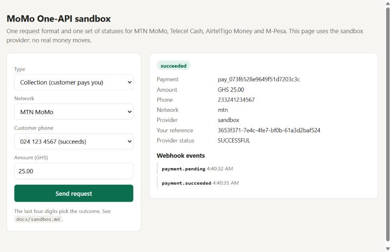

# Getting started

You need Node.js 22.13 or newer.

## 1. Try it with the sandbox (no money, no keys)

```bash
git clone https://github.com/Jacksonoseikojo1122/momo-one-api.git
cd momo-one-api && npm install
SANDBOX=on DEMO=on npm start      # http://localhost:8789
```

Open http://localhost:8789 for the demo page, or use the API:

```bash
curl -X POST localhost:8789/v1/collections \
  -H "content-type: application/json" -H "Idempotency-Key: order-1001" \
  -d '{ "amount": 2500, "currency": "GHS", "phone": "024 123 4567", "network": "mtn",
        "customer": { "email": "ama@example.com" }, "description": "Order 1001" }'
```

```json
{
  "id": "pay_073f6528e9649f51d7203c3c",
  "direction": "collection",
  "status": "pending",
  "amount": 2500,
  "currency": "GHS",
  "phone": "233241234567",
  "network": "mtn",
  "provider": "sandbox",
  "reference": "3653f371-7e4c-4fe7-bf0b-61a3d2baf524",
  "provider_reference": null,
  "provider_status": "PENDING",
  "failure": null,
  "action": null,
  ...
}
```

The background checker asks the provider about it after 15 seconds. To ask straight away:

```bash
curl -X POST localhost:8789/v1/payments/pay_073f6528e9649f51d7203c3c/refresh
# "status": "succeeded", "provider_status": "SUCCESSFUL", "completed_at": "..."
```

The last four digits of the phone number choose what the sandbox does. For example, `...0002` is insufficient funds and `...0004` needs an OTP. See [sandbox.md](sandbox.md).



## 2. Connect a real provider

Configure one or both. See [providers.md](providers.md) for where to get each key.

```bash
# Paystack: MTN, Telecel and AirtelTigo in Ghana, M-Pesa in Kenya
PAYSTACK_SECRET_KEY=sk_test_...

# MTN MoMo directly (collections and/or disbursements)
MTN_COLLECTION_USER_ID=... MTN_COLLECTION_API_KEY=... MTN_COLLECTION_SUBSCRIPTION_KEY=...
MTN_DISBURSEMENT_USER_ID=... MTN_DISBURSEMENT_API_KEY=... MTN_DISBURSEMENT_SUBSCRIPTION_KEY=...
MTN_TARGET_ENVIRONMENT=sandbox

# Your API keys: required as soon as a real provider is configured
MOMO_API_KEYS=a-long-random-key
```

Then point each provider's webhooks at the API:
- **Paystack:** set the webhook URL in your dashboard to `https://<your-host>/webhooks/paystack`.
- **MTN:** set `MTN_CALLBACK_URL=https://<your-host>/webhooks/mtn?token=<MTN_CALLBACK_TOKEN>`.

## 3. Get told when payments finish

```bash
WEBHOOK_URL=https://your-app.com/webhooks/momo WEBHOOK_SECRET=a-long-random-secret
```

Every status change is sent there, signed, with retries. To get durable delivery, replay and a dashboard, point `WEBHOOK_URL` at a [Webhook Relay](https://github.com/Jacksonoseikojo1122/webhook-relay) `generic` source instead. It already checks this signature format. See [integration.md](integration.md#webhooks).

## Configuration

| Variable | Default | Meaning |
| --- | --- | --- |
| `PORT` | `8789` | HTTP port |
| `MOMO_API_KEYS` | none | Comma-separated keys for `/v1/*`. Required with any real provider |
| `SANDBOX` | `off` | `on` adds the sandbox provider |
| `SANDBOX_DELAY_MS` | `3000` | How long sandbox payments stay pending |
| `DEMO` | `off` | `on` serves the demo page at `/` (sandbox only) |
| `PAYSTACK_SECRET_KEY` | none | Enables Paystack |
| `MTN_COLLECTION_*`, `MTN_DISBURSEMENT_*` | none | Enables MTN MoMo (`USER_ID`, `API_KEY`, `SUBSCRIPTION_KEY`) |
| `MTN_BASE_URL` | MTN's sandbox | Your production base URL from MTN when you go live |
| `MTN_TARGET_ENVIRONMENT` | `sandbox` | The `X-Target-Environment` MTN gives you |
| `MTN_CURRENCIES` | `EUR` in the sandbox, else `GHS` | MTN's sandbox only accepts EUR |
| `MTN_CALLBACK_URL`, `MTN_CALLBACK_TOKEN` | none | Where MTN sends callbacks, and the token that URL must carry |
| `ROUTES` | automatic | e.g. `mtn=mtn_momo,telecel=paystack,airteltigo=paystack,mpesa=paystack` |
| `WEBHOOK_URL`, `WEBHOOK_SECRET` | none | Where your events go, and the key they're signed with |
| `DATABASE_URL` | none | Postgres. Without it, SQLite at `MOMO_SQLITE` (`momo.db`) |

Next: [integration](integration.md) · [how it works](how-it-works.md) · [providers](providers.md)
