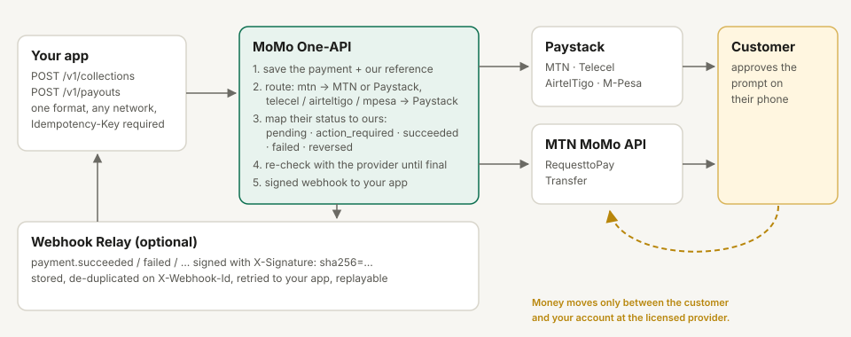

# How MoMo One-API works



## It never holds money

MoMo One-API is not a wallet and not a payment service provider.
- **Collections** go from the customer straight into your own account with the licensed provider (Paystack, or MTN MoMo directly).
- **Payouts** come out of that same account.

This service only sends the instructions, and records references and statuses. Running it doesn't need a Bank of Ghana licence. The money always moves through providers that already have one. You still need your own agreement with each provider.

## One request, any network

| Field | Meaning |
| --- | --- |
| `amount` | Minor units: pesewas for GHS (`2500` = GHS 25.00), cents for KES |
| `currency` | `GHS`, `KES`, or `EUR` (MTN's sandbox only) |
| `phone` | Any common format: `024 123 4567`, `0241234567`, `+233241234567`. Stored as `233241234567` |
| `network` | `mtn`, `telecel`, `airteltigo` or `mpesa` |
| `customer` | `email` (Paystack collections need one), `name` (payouts need one) |
| `provider` | Optional. Overrides the route for this request |
| `description`, `metadata` | Yours. Up to 20 metadata keys |

The network has to be given. In Ghana, numbers can move between networks (number portability), so the prefix doesn't reliably tell you which network a customer is on.

## One set of statuses

| Status | Meaning |
| --- | --- |
| `pending` | Sent to the provider. Usually waiting for the customer to approve on their phone |
| `action_required` | The provider needs something more. Today that's an OTP: send it to `POST /v1/payments/{id}/otp` |
| `succeeded` | Money moved |
| `failed` | Money didn't move. `failure.code` says why |
| `reversed` | A payout the network couldn't complete and sent back |

```
pending ◀──▶ action_required     (either can move to any of these)
   ├──▶ succeeded ──▶ reversed
   ├──▶ reversed
   └──▶ failed
```

`failed` and `reversed` are final. Every status change is written only if the payment is still in the state it was read in. A provider webhook, the reconciler and your API call can't overwrite each other.

## Failure codes

| `failure.code` | MTN reason | Paystack |
| --- | --- | --- |
| `declined` | `APPROVAL_REJECTED`, `PAYMENT_NOT_APPROVED`, `TRANSACTION_CANCELED` | `abandoned`, or a message about declining |
| `insufficient_funds` | `NOT_ENOUGH_FUNDS` | a message about insufficient funds |
| `expired` | `EXPIRED` | a message about expiry or timeout |
| `account_not_found` | `PAYER_NOT_FOUND`, `PAYEE_NOT_FOUND` | |
| `limit_reached` | `PAYER_LIMIT_REACHED` | |
| `not_allowed` | `NOT_ALLOWED`, `PAYEE_NOT_ALLOWED_TO_RECEIVE`, `INVALID_CURRENCY` | `rejected`, `blocked` transfers |
| `provider_error` | `INTERNAL_PROCESSING_ERROR`, `SERVICE_UNAVAILABLE` | a failed transfer with no reason |
| `unknown` | anything else | anything else |

The provider's own wording is always kept in `failure.message` and `provider_status`.

## Never charged twice, never lost

1. **`Idempotency-Key` is required** on every create. The same key with the same body returns the same payment, with no second provider call. The same key with a different body gets `409`.
2. **The payment is saved before the provider is called.** Each payment gets its own UUID `reference`, which is given to the provider: MTN's `X-Reference-Id`, Paystack's `reference`.
3. **A timeout or connection error leaves the payment `pending`.** It's never marked `failed`, because the request may have reached the provider. The reconciler then asks the provider about that reference. If the provider has never heard of it after two minutes, nothing can have moved, and the payment is marked `failed`.

## Webhooks in: trusted only after checking

- **Paystack webhooks** must carry a valid `x-paystack-signature`: HMAC-SHA512 of the body, using your secret key.
- **MTN callbacks** aren't signed, so the callback URL carries a secret token.

In both cases the callback body is never trusted for the status. The API asks the provider for the payment's current status and uses that answer.

## The reconciler

A background loop checks every open payment with the provider:
- after 15 s, 30 s, 1 m, 2 m, 5 m and 10 m;
- then every 15 minutes.

It never gives up on an open payment and never fails one on a timer.

Once a day, and on `POST /v1/reconciliation/run`, it re-checks every payment completed in the last 24 hours. If a provider now says something different, for example that a payment recorded as `failed` succeeded after all:
- the status is **not** changed;
- the payment gets a `mismatch` field;
- a `payment.mismatch` event is sent once.

A person should look at it. `GET /v1/reconciliation` lists counts by status, payments stuck open for over an hour, and mismatches.

This compares payment statuses with the provider. It is not a statement-level reconciliation against settlement reports. That needs each provider's reporting API, and it's planned.

## Webhooks out

Each status change becomes an event in an outbox: `payment.pending`, `payment.action_required`, `payment.succeeded`, `payment.failed`, `payment.reversed` or `payment.mismatch`.

Events are sent to `WEBHOOK_URL`, signed with `X-Signature: sha256=…`. Failed deliveries are retried after 10 s, 30 s, 2 m, 10 m and 30 m, then hourly, up to 12 attempts. See [integration.md](integration.md#webhooks).
