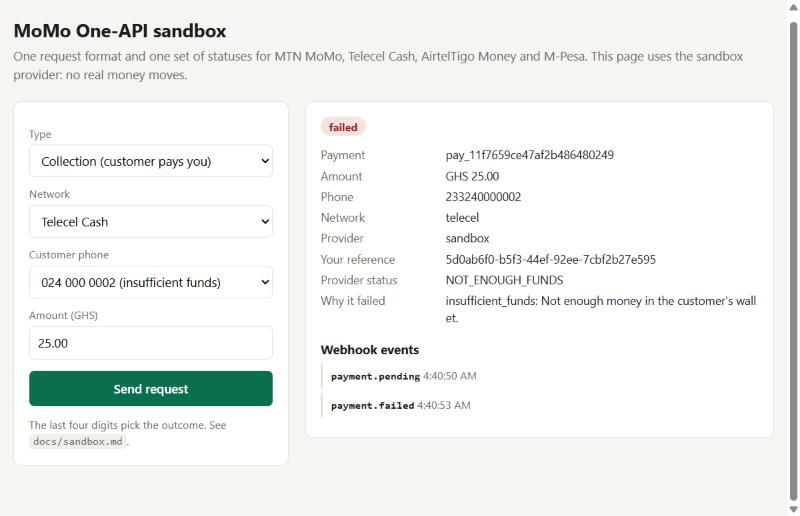
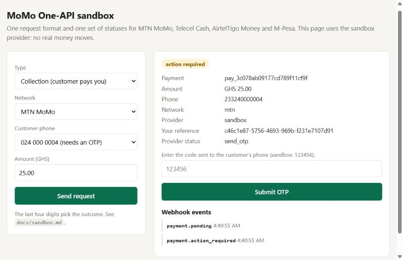

# Sandbox

`SANDBOX=on` adds a pretend provider. No money moves and no keys are needed. The last four digits of the customer's phone number choose what happens:

| Phone ends in | What happens | Final status |
| --- | --- | --- |
| `0001` | The customer declines | `failed` (`declined`) |
| `0002` | Not enough money in the wallet | `failed` (`insufficient_funds`) |
| `0003` | Never finishes | stays `pending`; shows as stuck after an hour |
| `0004` | Needs an OTP. `123456` is accepted | `action_required`, then `succeeded` |
| `0005` | A payout succeeds, then comes back | `succeeded`, then `reversed` |
| anything else | Works | `succeeded` |

Outcomes arrive after `SANDBOX_DELAY_MS` (3 seconds by default). Before that, the payment is `pending`, like a real customer taking a moment to approve.

```bash
SANDBOX=on DEMO=on npm start
```

`DEMO=on` serves the page at http://localhost:8789, which shows each case moving through its states:





The sandbox can run alongside real providers. Send `"provider": "sandbox"` on a request to use it for that request only.
